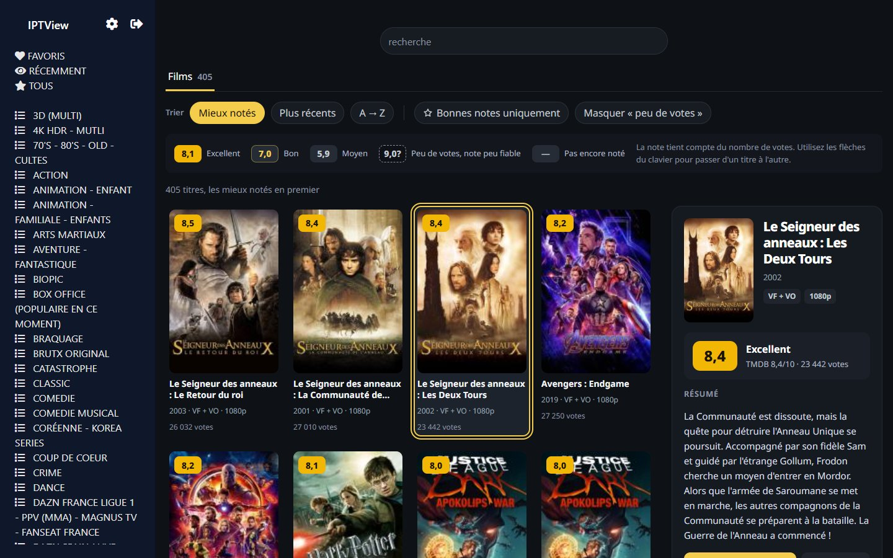
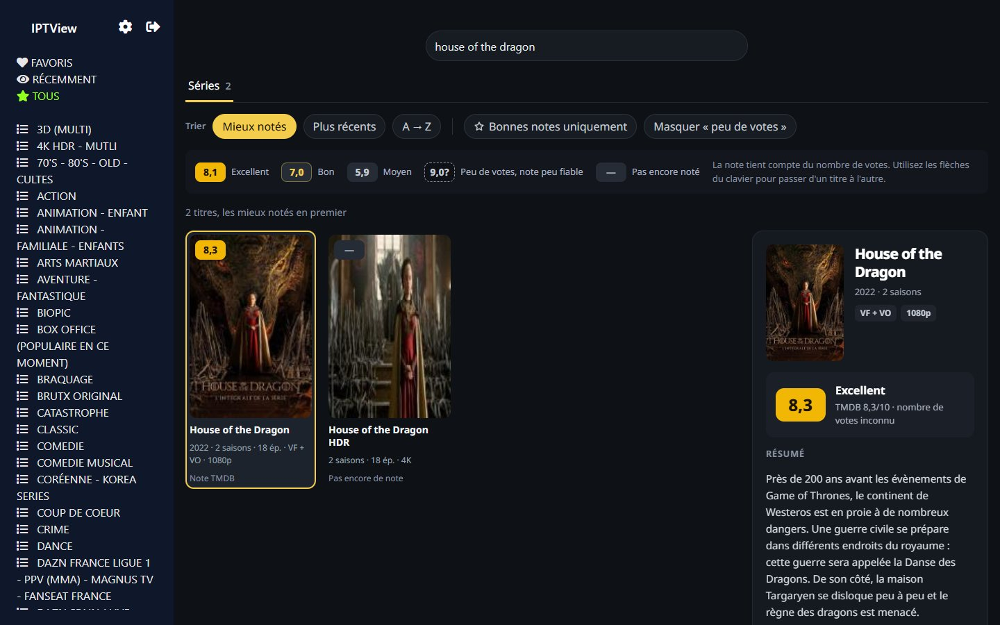
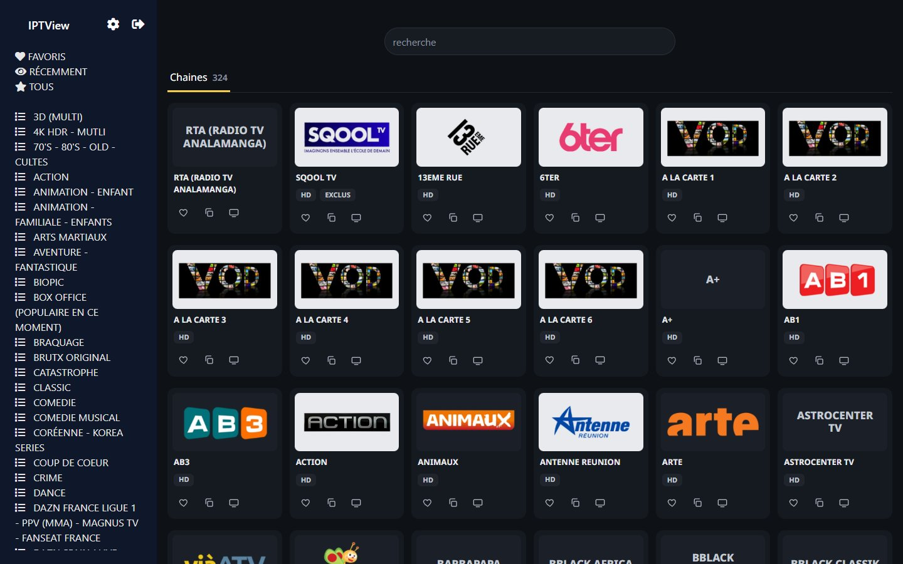
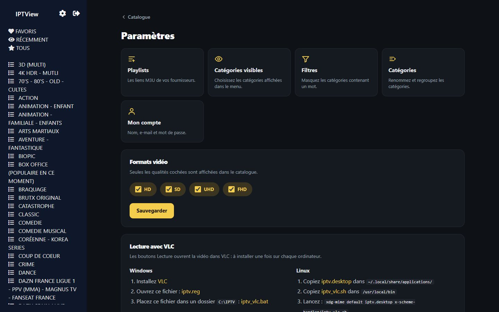

## Description

Web interface to browse your IPTV provider everywhere: movies, series and TV channels from your M3U playlists, with TMDB ratings and summaries.

Features:
- catalog of movies, series and channels, with posters, summaries and seasons / episodes
- weighted ratings: a note with few votes is pulled towards the average, so 9/10 from 2 votes does not rank above 7.9/10 from 29,000 votes
- sort by best rated, most recent or A → Z, filters "good ratings only" and "hide few votes"
- doubtful TMDB records flagged (the year of the title does not match the record)
- keyboard navigation: arrow keys move between titles
- favorites, history and resume position per user
- channel logos on readable tiles, channel name when the logo is missing
- categories: hide the ones you do not want (whitelist and word filters), rename and group them
- multiple playlists and users
- playback with VLC, short link to send a stream to the TV
- dark theme, languages: en / fr

## Requirements
- PHP 8.3 with the sqlite, gd and curl extensions
- Composer (https://getcomposer.org/download/)
- Node.js and npm, to compile the assets
- VLC on each computer that plays the videos (https://www.videolan.org/vlc/)

## Installation
````
cp .env.example .env
````
Set your variables in `.env`:
- `M3U`: the M3U link of your provider (more playlists can be added later in Settings › Playlists)
- `ADMIN_USER` / `ADMIN_PASSWORD`: the first administrator
- `TMDB_KEY`: your TMDB API key (https://www.themoviedb.org), for the ratings, summaries and posters
- `APP_LOCALE`: `en` or `fr`

Then:
````
composer install
php artisan key:generate
php artisan migrate --seed
npm install
npm run build
php artisan refresh:playlist
php artisan refresh:info
````

### Playing the videos
The players never get the provider urls (they hold the credentials of the subscription): every link (Play, Copy link, Send to TV) is a link of this site, `/s/<personal key>/<id>`, which redirects to the stream. If a link went out, Settings › My play links makes new ones and the previous ones stop working (an admin can do it for any user in Users).

The Play buttons open the videos in VLC. On a computer, they download by default a small VLC playlist (`.xspf`, with the resume position): check « Always open files of this type » once in the browser and the next videos open in one click, nothing to install but VLC. A computer can use instead the `iptv://` links, with a small handler installed once (Settings › Play with VLC, chosen on each computer). On Android, the links open VLC directly (`intent:` links, the video starts where you left it), on iPhone and iPad through `vlc-x-callback://`: only VLC is needed.

## Updating the library
````
php artisan refresh:playlist   # import the playlists: new titles, moved ones, and removal of the ones gone
php artisan refresh:info       # TMDB ratings, summaries and posters (only the titles not done yet)
````
`refresh:info` accepts `--limit=N` to process only N titles, and `--doubtful` to search again the titles whose TMDB year is far from the year of their name (shown with a « TMDB data to check » warning): the result released that year is now preferred.

## Tests
````
php artisan test
````
The tests run on an in-memory database (forced in `phpunit.xml`, checked in `tests/TestCase.php`): never on `database.sqlite`.

## Settings
- **Playlists**: the M3U links, and the IP to use when your DNS blocks the provider
- **Visible categories**: only the checked categories are shown; the new ones stay hidden until you check them
- **Filters**: hide every category containing a word
- **Categories**: rename the categories; the ones ending up with the same name are grouped
- **Users** (administrators) and **My account**

## Docker
Image: `ynizon/iptv` (built and pushed by the GitHub workflow on every push to `main`).

The application is in the image; a single folder keeps your data:
````
docker run -d --name iptv -p 8051:80 -v /path/on/your/host/iptv-data:/data ynizon/iptv
````

`/data` holds:
- `.env`: your settings (`M3U`, `ADMIN_USER`, `ADMIN_PASSWORD`, `TMDB_KEY`...), created from `.env.example` on the first start
- `database.sqlite`: playlists, catalog, users, favorites and history (with `database.sqlite-wal` / `-shm` next to it)
- `images/`: cache of the posters and channel logos
- `storage/`: logs (`storage/logs/cron.log` for the nightly refreshes), sessions

The container runs nginx (static files and pictures already made served directly, kept by the browser) with PHP-FPM and OPcache.

At startup, the container creates what is missing in `/data`, runs the migrations (and the seeder on a new database), caches the settings, routes and views (restart it after changing `/data/.env`), then starts cron, PHP-FPM and nginx. Cron: every night at 2:00 (container time, UTC), `refresh:playlist` imports the playlists, then `refresh:info` fetches TMDB data for the new titles.

After the first start, set your variables in `/data/.env` and restart the container.

To update: pull the new image and recreate the container with the same `/data` folder:
````
docker pull ynizon/iptv
docker rm -f iptv
docker run -d --name iptv -p 8051:80 -v /path/on/your/host/iptv-data:/data ynizon/iptv
````

### Coming from the former setup (volume on /var/www)
Copy your data from the former volume into the new folder, before the first start:
````
cp /former/volume/.env                          iptv-data/.env
cp /former/volume/database/database.sqlite*     iptv-data/
mkdir -p iptv-data/images && cp -r /former/volume/public/images/playlist/. iptv-data/images/
````
The container adds `DB_DATABASE=/data/database.sqlite` to `.env` by itself.

## Screenshots





