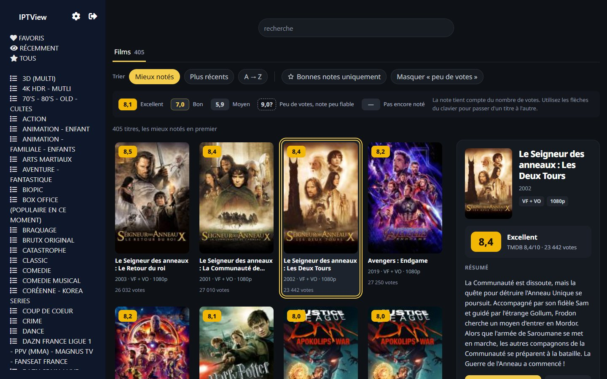
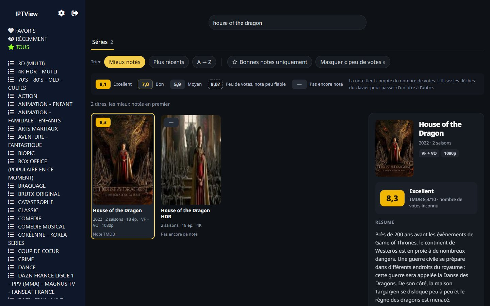
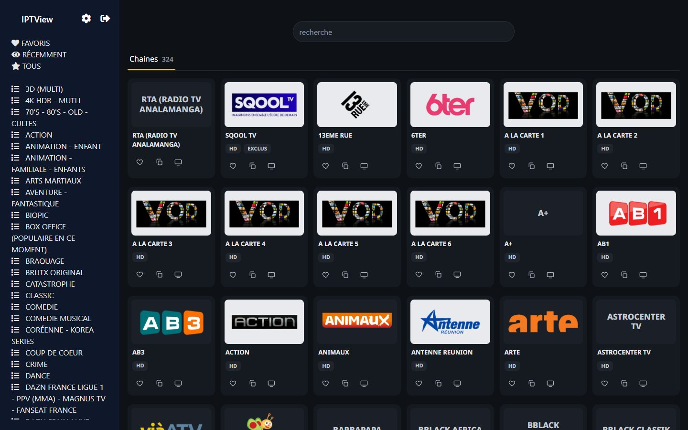
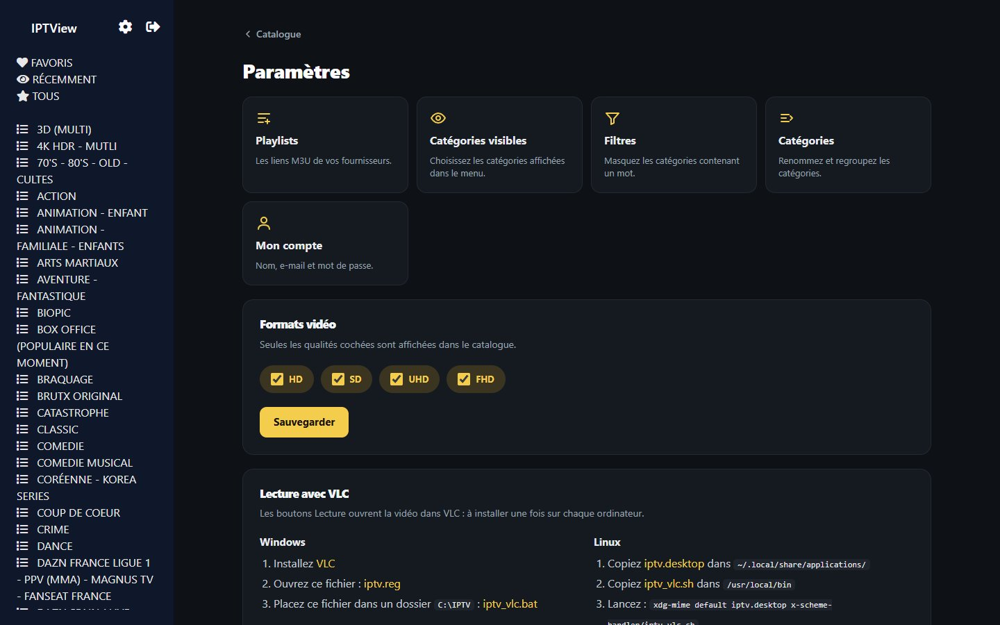

## Description

Web interface to browse your IPTV provider everywhere: movies, series and TV channels from your M3U playlists, with TMDB ratings and summaries.

Features:
- catalog of movies, series and channels, with posters, summaries and seasons / episodes
- weighted ratings: a note with few votes is pulled towards the average, so 9/10 from 2 votes does not rank above 7.9/10 from 29,000 votes
- sort by best rated, most recent or A → Z, filters "good ratings only" and "hide few votes"
- doubtful TMDB records flagged (the year of the title does not match the record)
- keyboard navigation: arrow keys move between titles
- favorites, history and resume position per user
- channel logos on readable tiles, channel name when the logo is missing
- categories: hide the ones you do not want (whitelist and word filters), rename and group them
- multiple playlists and users
- playback with VLC, short link to send a stream to the TV
- dark theme, languages: en / fr

## Requirements
- PHP 8.3 with the sqlite, gd and curl extensions
- Composer (https://getcomposer.org/download/)
- Node.js and npm, to compile the assets
- VLC on each computer that plays the videos (https://www.videolan.org/vlc/)

## Installation
````
cp .env.example .env
````
Set your variables in `.env`:
- `M3U`: the M3U link of your provider (more playlists can be added later in Settings › Playlists)
- `ADMIN_USER` / `ADMIN_PASSWORD`: the first administrator
- `TMDB_KEY`: your TMDB API key (https://www.themoviedb.org), for the ratings, summaries and posters
- `APP_LOCALE`: `en` or `fr`

Then:
````
composer install
php artisan key:generate
php artisan migrate --seed
npm install
npm run build
php artisan refresh:playlist
php artisan refresh:info
````

### Playing the videos
The Play buttons open the videos in VLC. Settings › Play with VLC explains how to set it up on Windows and Linux.

## Updating the library
````
php artisan refresh:playlist   # import the playlists
php artisan refresh:info       # TMDB ratings, summaries and posters (only the titles not done yet)
````
`refresh:info` accepts `--limit=N` to process only N titles.

## Settings
- **Playlists**: the M3U links, and the IP to use when your DNS blocks the provider
- **Visible categories**: only the checked categories are shown; the new ones stay hidden until you check them
- **Filters**: hide every category containing a word
- **Categories**: rename the categories; the ones ending up with the same name are grouped
- **Users** (administrators) and **My account**

## Docker
Image: `ynizon/iptv` (built and pushed by the GitHub workflow on every push to `main`).

- Port: map a port of your host to `80`, for example `8051 -> 80`
- Volume: map a folder of your host to `/var/www`

At startup, the container:
- copies the application into `/var/www` when the volume is empty, then creates `.env` and the database when they are missing
- compiles the assets (`npm run build`) and runs the migrations
- starts cron: `refresh:info` runs every night at 2:00 (container time, UTC)

To update a running container: `git pull` in `/var/www`, then restart the container.

## Screenshots





